  

  
  
  
  

  UNLV computer science grad (Information Assurance concentration) and NSF CyberCorps Scholarship for Service scholar. 
  Started in IT at the family's internet cafe, fixing PCs and cleaning malware. Now hardens Linux boxes, runs a segmented Proxmox homelab, automates the boring parts, and points machine learning at problems that need it.

  <b>Now:</b> Associate in Engineering (part-time) at Mission Support and Test Services (NNSS), since Sep 2025. 
  Automating seismic arrival-time picking with machine learning.

  

<!-- ChutaTrip stats: edit the numbers below -->

  <b>1&nbsp;month</b>&nbsp;of&nbsp;real&nbsp;travel&nbsp;in&nbsp;Japan &middot;
  <b>3,118</b>&nbsp;automated&nbsp;tests &middot;
  <b>1,169</b>&nbsp;commits,&nbsp;built&nbsp;solo &middot;
  <b>75+</b>&nbsp;releases&nbsp;in&nbsp;3&nbsp;months &middot;
  <b>9</b>&nbsp;languages &middot;
  <b>10</b>&nbsp;travelers&nbsp;per&nbsp;trip

  <a href="https://www.chutatrip.com">ChutaTrip</a> &middot;
  <a href="https://keithdanieltan.com">This portfolio</a>

  

  <a href="https://arxiv.org/abs/2512.16065">Read the paper</a> &middot;
  <a href="https://www.certmetrics.com/comptia/public/verification.aspx?code=W4DV888TXZK6NRVJ">Verify Security+</a>

  

  

  

<!--
Regenerating the images in assets/ (Python 3 and Pillow; the fonts are committed in scripts/fonts):
  python3 scripts/build.py /path/to/keitan-website
It reads the palette, pixel art and icons from that checkout, so rerun it when those change.
Output is deterministic. The ChutaTrip stats under the quest log are plain README text.
scripts/subset_fonts.py (needs fonttools) rebuilds the font subsets; the fonts are SIL OFL 1.1.
-->
